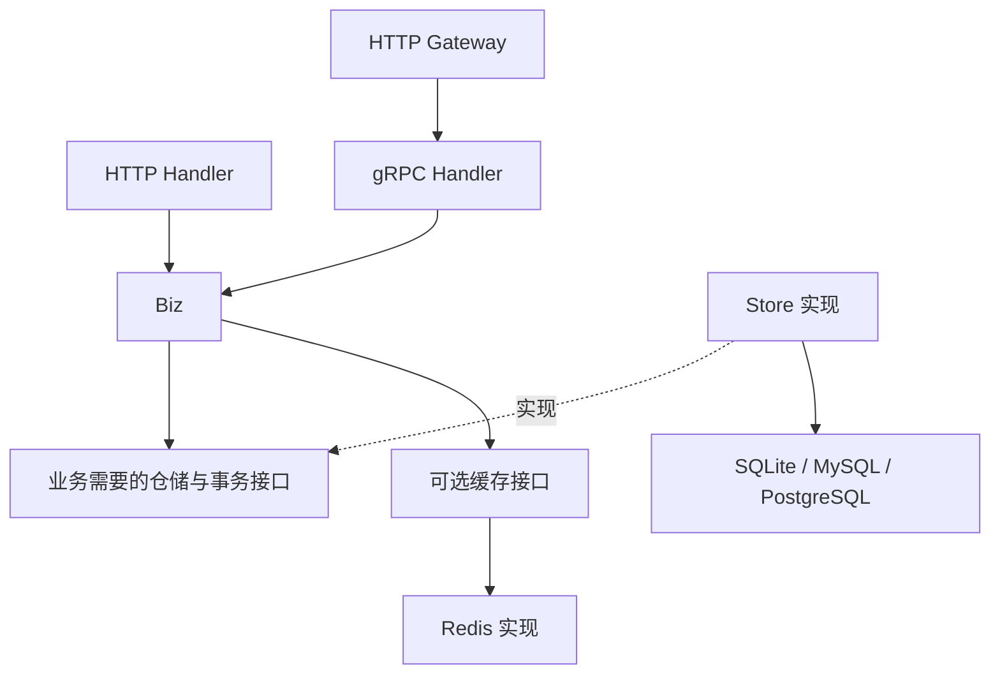

# 技术架构

本文件描述待实现的目标架构；具体完成状态以 ROADMAP 为准。

## 整体结构

goseed 分为生成器和业务模板。生成器读取参数或业务声明，规划、校验并渲染源码；生成项目不依赖生成器运行。


运行时使用实用三层架构：HTTP/gRPC Handler 适配协议，Biz 执行业务，Store 实现持久化。无需为简单 CRUD 预先建立完整 Domain、UseCase、Repository 多套同义层。



该图描述可选路径，不表示默认同时启动所有协议或数据库。协议入口由命令契约决定。

## 生成器目录

```text
goseed/
├── AGENTS.md
├── README.md
├── ROADMAP.md
├── docs/
├── cmd/goseed/
├── internal/
│   ├── cli/
│   ├── generator/
│   └── templates/
├── tests/
│   ├── compatibility/
│   └── integration/
├── Makefile
├── go.mod
└── go.sum
```

代码与构建文件在对应阶段创建。模板为唯一实现来源，不独立维护一套易漂移的完整示例仓库。测试从模板生成项目并验证实际产物。

D2 的默认 HTTP 模板集中在 `internal/templates/base/`，文件使用 `.tmpl` 后缀，模板变量使用 `[[...]]` 分隔符以避开 Go 复合字面量。渲染返回完整文件计划，校验并格式化 Go 源码；测试负责写入本次专用临时项目。公开 CLI 的生成写入与参数组合仍在 D5 接入。

Go 工具链固定为 `1.26.4`，主模块为 `github.com/setcreed/goseed`。兼容性测试使用独立 Go 模块，候选业务运行依赖不进入生成器主模块；验证原型不作为未来业务模板的运行依赖。

标准库 `embed` 嵌入模板，`text/template` 渲染，`go/format` 格式化。生成器以明确的登记文件集成模块，优先避免 AST 改写手工业务文件。模板按基础能力和特性组织，避免复制大量完整项目变体。

## 生成业务项目目录

```text
shop/
├── AGENTS.md
├── README.md
├── ROADMAP.md
├── goseed.yaml
├── cmd/apiserver/
│   ├── main.go
│   └── app/
├── internal/
│   ├── apiserver/
│   │   ├── bootstrap/
│   │   │   ├── providers.go
│   │   │   └── modules_gen.go
│   │   ├── server.go
│   │   ├── router.go
│   │   ├── handler/
│   │   │   ├── http/example/
│   │   │   └── grpc/example/
│   │   ├── biz/example/
│   │   ├── store/example/
│   │   └── model/
│   └── pkg/
│       ├── config/
│       ├── contextx/
│       ├── errno/
│       ├── log/
│       ├── middleware/
│       └── server/
├── api/
│   ├── openapi/
│   └── proto/apiserver/v1/
├── pkg/api/apiserver/v1/
├── configs/app.example.yaml
├── migrations/
├── specs/
├── build/docker/
├── deployments/compose/
├── docs/
├── Makefile
├── go.mod
└── go.sum
```

这是能力全集示意，实际按参数生成：HTTP-only 不生成 gRPC、Proto 与公开 Go 协议包；grpc-only 不生成 Gin 业务 Handler；Gateway 不生成同一业务的 Gin Handler；无数据库不生成 Store、Model 或数据库迁移。只有存在实际内容时才创建目录。

`pkg/api` 只承载供 Go 客户端导入的生成协议类型，不作为公共工具杂物目录。`api/v1` 表达协议版本，Biz 不默认按版本分目录。

`goseed.yaml` 是版本化生成元数据，包含模板版本、模块路径、能力选择和业务登记。它不是服务运行配置，也不能作为容器中的必需文件。

## 技术方案

| 能力 | 拟采用方案 | 引入目的与边界 |
|---|---|---|
| 命令 | Cobra | 处理生成器子命令、参数和帮助 |
| HTTP | Gin | 路由与中间件，与 Biz 隔离 |
| gRPC | grpc-go + Protobuf | 可选协议契约与服务入口 |
| Gateway | grpc-gateway | 根据 Proto 生成 HTTP 映射 |
| ORM | GORM | 简化常用 CRUD；数据库对象限于 Store |
| SQLite | `github.com/libtnb/sqlite` | 底层 modernc，纯 Go 构建 |
| MySQL | `gorm.io/driver/mysql` | 官方数据库接入 |
| PostgreSQL | `gorm.io/driver/postgres` | 官方数据库接入，底层 pgx |
| 依赖注入 | `samber/do/v2` | 只用于应用组装，替代代码生成式 DI |
| 配置 | Viper | 合并文件、环境变量与显式参数，输出强类型配置 |
| 日志 | Zap | 统一结构化日志与数据库日志接入 |
| 迁移 | Goose | 显式、版本化 SQL 迁移 |
| JWT | `golang-jwt/jwt/v5` | 标准 Token 签发与验证 |
| 授权 | Casbin + 复用现有 GORM 连接的最小适配器 | 可选 RBAC 与策略持久化，显式迁移 |
| 缓存 | `go-redis/v9` | 可选 Redis 客户端 |
| 验证 | Go test、race、vet、golangci-lint | 实际生成产物与关键失败路径验证 |

固定版本、维护证据、许可证与已知限制见 [依赖核验](dependencies.md) 和 [版本清单](../dependencies.lock.json) 。版本锁定不代表业务模板已实现；运行验证状态以 ROADMAP 为准。升级依赖前重新核验，不使用 `@latest` 作为可复现版本。

模板与文件规划由标准库完成，不引入通用脚手架框架。使用第三方库的范围限于其成熟协议、ORM、认证和工程能力，不叠加同类库。

能力依据包括：[GORM 数据库接入](https://gorm.io/docs/connecting_to_the_database.html)、[do](https://github.com/samber/do)、[Viper](https://github.com/spf13/viper)、[Zap](https://github.com/uber-go/zap)、[Goose](https://github.com/pressly/goose)、[grpc-gateway](https://github.com/grpc-ecosystem/grpc-gateway) 。这些链接说明能力来源，不代替正式依赖维护核验。

## 分层与业务类型

Handler 解析请求，进行协议基础校验并映射响应；Biz 处理规则、资源归属、流程和事务需求；Store 负责 SQL 与持久化错误转换。

Biz 使用独立输入输出，不直接使用 Gin Context 或 Proto 消息。HTTP DTO 位于 HTTP Handler 附近，Proto 消息仅在 gRPC/Gateway 边界转换。简单 CRUD 可使用数据库模型，业务复杂后按实际需求增加独立业务实体。

小型仓储接口定义在使用它的 Biz 模块附近，Store 实现该接口。避免庞大的全项目 Store 接口、无用途的扩展接口，以及将通用查询构造器暴露到 Biz。

转换代码显式表达可读、可写字段，尤其不能把请求 ID、所有者或审计字段自动复制到数据库。日志与中间件等通用基础包不得依赖具体业务模型。

## 依赖组装与服务生命周期

组件使用普通构造函数。Bootstrap 注册 do provider 并主动构建全部必需组件，业务代码不使用 `Invoke`、全局容器或服务定位器。泛型 API 不意味着依赖图在编译期完整校验，缺失与循环依赖必须在监听前暴露。

配置 → 日志 → 数据库/Redis → Store → Biz → Handler → 服务，是初始化顺序。由应用生命周期统一持有清理职责，避免容器与应用重复关闭同一资源。

启动错误沿调用链返回，不在底层调用 Fatal 退出。任一步失败，关闭已创建的资源和监听器。多个服务启动时，处理任意入口监听失败和其他入口的回收。

关闭时先变为不就绪，再停止接收并排空请求，最后关闭数据库、缓存、客户端和日志。Gateway 先排空 HTTP，再关闭其依赖的 gRPC 与客户端连接。gRPC 优雅关闭到期后使用强制停止兜底，所有关闭操作在统一预算内完成。

## 配置管理

- 单个服务使用独立 Viper 实例，最终输出强类型 `Config`。
- 覆盖顺序固定为默认值 < 配置文件 < 环境变量 < 显式命令行参数。
- 显式绑定已知键的环境变量，不依赖自动环境读取恰好能完成结构体反序列化。
- 校验未知字段、枚举、地址、超时、连接池范围与必需凭据；时间单位必须明确。
- 显式配置文件缺失或格式错误时失败；默认配置文件不存在时仅在所需配置已由其他来源提供的情况下继续。
- 本地开发配置和随机密钥不入 Git，生产密钥来自外部配置；生产缺失密钥直接失败。
- 第一版不做热更新，不打印完整配置或 DSN。

运行环境必须显式区分开发与生产。生产配置不能启用开发 Token 签发入口或自动生成临时密钥。

## 日志与错误

生产 JSON 标准输出，开发可读输出。统一字段包括 RFC3339 格式 UTC 时间、级别、服务、版本、请求 ID 与必要错误上下文；用户标识仅在有明确需要时记录。

HTTP 访问日志与 RPC 日志记录方法、状态和耗时；不默认记录请求正文、Token、密码、SQL 参数或可能包含敏感值的原始 URL 查询。GORM 日志接入统一日志系统，慢查询按阈值记录。

错误保留内部原因，用稳定业务码在 Handler 边界映射到 HTTP/gRPC 状态；不向客户端返回 SQL、堆栈或内部服务地址。同一错误在处理边界记录，避免逐层重复日志。

## 数据库与事务

所有操作使用请求 Context。连接池与超时按数据库配置；SQLite 单独设置 WAL、外键、busy timeout，并验证配置对实际连接生效，不能只给一个连接执行 PRAGMA 就声称完成。

SQLite 数据放入明确持久化目录；数据库、WAL、SHM 文件不入 Git。备份需使用一致性备份流程，不能在有活动 WAL 的情况下仅复制主文件。多实例共享写入及高并发写入场景选择 MySQL/PostgreSQL，部署指南说明边界。

Biz 定义事务需求；Store 提供绑定到同一事务的仓储，跨仓储写入整体提交或回滚。事务回调中不混用原始连接，不将 GORM 事务对象暴露到 Biz。首版避免隐式嵌套事务抽象。

迁移按数据库方言生成，显式执行。业务与 Casbin 表都纳入同一迁移机制，不让策略适配器暗中 AutoMigrate。使用复用现有 GORM 连接的最小策略适配器，避免官方适配器同时引入额外驱动；D1 验证原型与正式实现分开，D3 补齐输入约束、Context 和受控策略操作。

通用业务操作保持一致，但不保证任意 SQL、隔离级别或特有类型跨数据库完全等价。数据库切换与数据搬迁需独立评估。

## JWT、Casbin 与 Redis

JWT 固定允许的算法并验证签名、到期、签发方、接收方和主体；要求必要声明存在，不仅验证声明存在时的值。解析前校验三段 Base64URL 字符语法，拒绝 CR/LF 等非法字符。Token 从 HTTP Authorization 或 gRPC metadata 读取，统一进入身份上下文。

Casbin 使用稳定资源与操作，例如 `product:read`；HTTP 与 RPC 登记映射到相同权限。公共入口显式登记，其他入口默认要求认证；授权模型默认拒绝。Biz 继续检查资源归属及业务状态。

只读文件策略在启动时加载并校验，首版不热更新。数据库策略在启动时读取，策略修改通过受控应用接口维护，不自动开放公开管理 API。跨实例同步属于后续范围。

Redis 缓存采用 Cache-Aside 示例：查询命中返回，未命中从数据库加载并设置 TTL，写入后失效。缓存故障按可选/必需声明处理。Redis 是可选能力，不自动承载 JWT 撤销列表或 Casbin 策略。

## 多协议与接口文档

使用同一组业务输入校验规则，分别处理 JSON 与 Proto 的字段存在性、默认值和分页语义。更新操作要区分未提供与零值，不能让协议转换丢失语义。

HTTP 使用稳定错误结构和正确状态码；gRPC 输出匹配的 Status，Gateway 配置匹配的状态与错误转换。转发请求 ID、Authorization、deadline 与取消，避免 Gateway 绕过 RPC 安全链。

Proto 源和生成 Go 代码分目录；普通构建使用已生成文件，修改契约后显式生成。工具在项目范围固定版本，不通过构建自动安装全局工具。

HTTP 模式维护接口文档；Gateway 文档从 Proto 生成；dual 对两套契约做一致性测试。首版统一输出 Swagger 2.0（OpenAPI 2.0），不标记为 OpenAPI 3.x。协议工具版本和官方资产摘要见依赖清单。

标准 gRPC Health 在启动、依赖故障与关闭时维护真实状态。Reflection 和 pprof 由运行配置显式开启，生产默认关闭。HTTP 配置请求体大小、超时、分页上限、排序白名单及允许来源；TLS 客户端正确校验证书，生产不允许跳过验证。

## 生成可靠性与验证

先在内存或任务临时目录构造完整计划，验证全部渲染内容、协议工具、路径与冲突，再写入。拒绝通过符号链接写到项目之外。文件提交阶段失败时只清理本次创建且可确定归属的文件，报告无法撤回的变化。

业务生成更新登记元数据及 `_gen.go` 汇总文件，其他业务源码不再生成。登记文件需要归属标记和修改检测，防止覆盖手工改动。协议登记方案在业务生成检查点先形成可编译样例，再据此实现。

全部合法能力组合至少通过生成和编译检查；运行集成按代表组合交叉覆盖，单独验证三种真实数据库、四种协议、认证授权及 Redis 故障。遇到环境缺失时记录未验证范围，不把编译成功等同运行验证。
