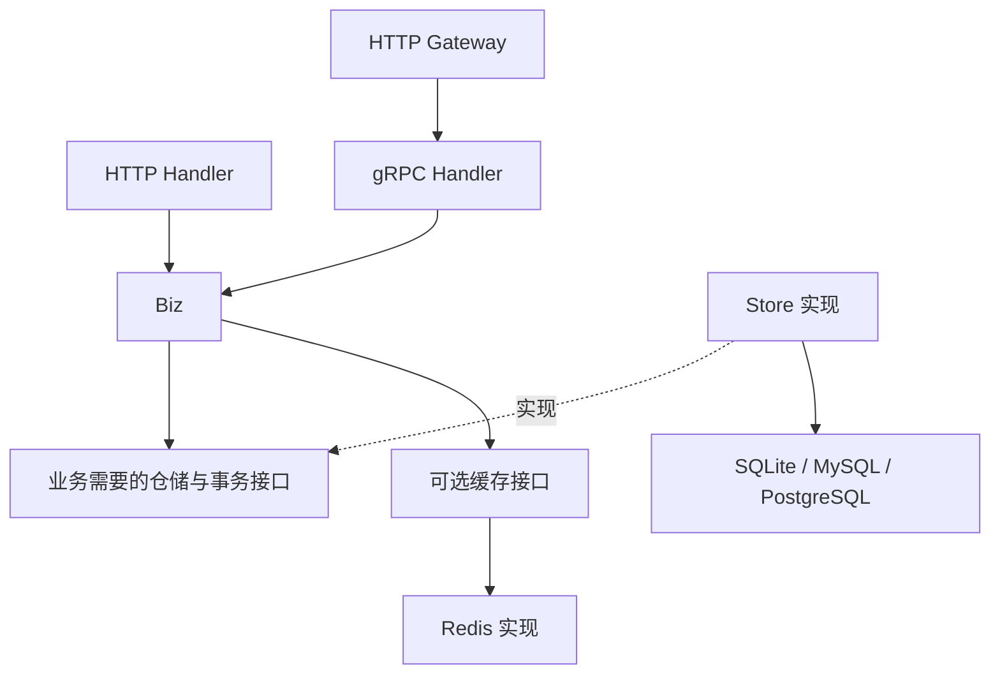

# 技术架构

本文件说明项目架构、分层与技术约定；当前状态以 ROADMAP 为准。贡献者构建与验证入口见 [开发指南](development.md)。

## 整体结构

goseed 分为生成器和业务模板。生成器读取参数或业务声明，规划、校验并渲染源码；生成项目不依赖生成器运行。


运行时使用实用三层架构：HTTP/gRPC Handler 适配协议，Biz 执行业务，Store 实现持久化。无需为简单 CRUD 预先建立完整 Domain、UseCase、Repository 多套同义层。



该图描述可选路径，不表示默认同时启动所有协议或数据库。协议入口由命令契约决定。

## 生成器目录

```text
goseed/
├── AGENTS.md
├── README.md
├── ROADMAP.md
├── docs/
├── cmd/goseed/
├── internal/
│   ├── cli/
│   ├── generator/
│   └── templates/
├── tests/
│   ├── compatibility/
│   └── integration/
├── Makefile
├── go.mod
└── go.sum
```

代码与构建文件在对应阶段创建。模板为唯一实现来源，不独立维护一套易漂移的完整示例仓库。测试从模板生成项目并验证实际产物。

D2 的默认 HTTP 模板集中在 `internal/templates/base/`，文件使用 `.tmpl` 后缀，模板变量使用 `[[...]]` 分隔符以避开 Go 复合字面量。隐藏输出文件使用 `dot.<name>.tmpl` 命名，例如 `dot.gitignore.tmpl` 输出 `.gitignore`，避免嵌入系统隐藏元数据。渲染返回完整文件计划，校验并格式化 Go 源码；测试负责写入本次专用临时项目。公开 CLI 的生成写入与参数组合仍在 D5 接入。

可选能力集中在 `internal/templates/variants/`：`sql/` 提供外部 SQL 共用实现，`mysql/`、`postgres/`、`none/` 提供存储差异，`redis/`、`casbin/`、`grpc/`、`dual/`、`gateway/` 提供能力叠加。Render 按所选能力合并文件计划，纯 gRPC 裁剪 HTTP 文件，dual 保留两种 Handler，Gateway 只保留 RPC Handler 并增加真实 HTTP 转发；完整依赖清单按组合固定，不在渲染时查询或生成依赖版本。

Go 最低版本为 `1.26.4`，由各模块 `go.mod` 声明；日常开发与验证使用本机兼容工具链，发行归档单独固定版本。主模块为 `github.com/setcreed/goseed`。兼容性测试使用独立 Go 模块，候选业务运行依赖不进入生成器主模块；验证原型不作为未来业务模板的运行依赖。

标准库 `embed` 嵌入模板，`text/template` 渲染，`go/format` 格式化。生成器以明确的登记文件集成模块，优先避免 AST 改写手工业务文件。模板按基础能力和特性组织，避免复制大量完整项目变体。

## 生成业务项目目录

```text
shop/
├── AGENTS.md
├── README.md
├── ROADMAP.md
├── goseed.yaml
├── cmd/
│   ├── apiserver/
│   │   ├── main.go
│   │   └── app/
│   └── exampleclient/
├── internal/
│   ├── apiserver/
│   │   ├── bootstrap/
│   │   │   ├── providers.go
│   │   │   ├── module_<name>.go
│   │   │   ├── module_permissions.go
│   │   │   └── modules_gen.go
│   │   ├── router.go
│   │   ├── handler/
│   │   │   ├── http/example/
│   │   │   └── grpc/example/
│   │   ├── biz/example/
│   │   ├── store/example/
│   │   └── model/
│   └── pkg/
│       ├── auth/
│       ├── authz/
│       ├── cache/
│       ├── config/
│       ├── contextx/
│       ├── database/
│       ├── dual/
│       ├── gateway/
│       ├── errno/
│       ├── log/
│       ├── middleware/
│       ├── rpc/
│       └── server/
├── api/
│   ├── openapi/
│   └── proto/example/v1/
├── pkg/api/example/v1/
├── configs/app.example.yaml
├── migrations/
├── specs/
├── build/docker/
├── deployments/compose/
├── deploy/                    # 显式 --deployment 生成的 systemd/Nginx 副本
├── docs/
├── Makefile
├── go.mod
└── go.sum
```

这是目标能力全集示意，实际按参数生成：HTTP-only 不生成 gRPC、Proto、示例 RPC 客户端与公开 Go 协议包；grpc-only 不生成 Gin 业务 Handler；dual 保留两种 Handler，使用 `internal/pkg/dual/` 协调生命周期；Gateway 不生成同一业务的 Gin Handler；无数据库不生成 Store、Model 或数据库迁移。授权、缓存目录只在选择对应能力时生成，只有存在实际内容时才创建目录。

单机部署资产由项目生成参数选择，位于独立 `deploy/`，不属于业务运行源码。它不修改主机或自动执行迁移；systemd/Nginx 信任、权限和备份恢复边界见 [单机部署契约](deployment.md)。

`goseed.yaml` 由 D5 项目生成器创建，记录模板版本、能力与初始业务模块；D6 扩展其中的模块清单。`internal/apiserver/bootstrap/modules_gen.go` 是清单的确定性生成投影，负责把模块构造接入启动组装，并提供协议登记描述：HTTP 路由回调、gRPC Service 注册回调及 Gateway 的路径、query/body 规则和映射回调。各协议使用自己的描述类型；缺少的协议类型和依赖随模板裁剪。登记回调由当前 Handlers 的方法适配，不通过 AST 改写手工 Bootstrap、路由或 Proto 文件。`specs/` 保存资源字段声明，由生成器读取并校验。部署目录按交付需求创建，当前文件交付范围以 README 与实际模板为准，检查点状态以 ROADMAP 为准。

`pkg/api` 只承载供 Go 客户端导入的生成协议类型，不作为公共工具杂物目录。`api/proto/<module>/v1` 保存业务模块的 Proto，Gateway 在相同目录维护 `http.yaml` 映射，`pkg/api/<module>/v1` 保存对应生成代码；`v1` 表达协议版本，Biz 不默认按版本分目录。gRPC 的服务与拦截器位于 `internal/pkg/rpc/`，dual 的监听与关闭协调位于 `internal/pkg/dual/`，Gateway 的转发与顺序关闭位于 `internal/pkg/gateway/`；协议运行约束见[模板指南](templates.md#纯-grpc-模板)。

`goseed.yaml` 是版本化生成元数据，包含元数据版本、模板版本、项目名、模块路径、能力选择和模块登记；资源登记记录 spec 路径与字段规范版本。它不是服务运行配置，也不能作为容器中的必需文件；后续业务生成器读取它并拒绝不兼容的模板版本或能力。模块清单是登记权威来源；`modules_gen.go` 带生成标记、模块清单摘要及 OpenAPI 汇总摘要，每次生成前必须验证摘要及其内容与清单一致。`api/openapi/<module>.yaml` 是各模块的 OpenAPI 源文件，`api/openapi/swagger.json` 是按确定顺序合并的生成索引。HTTP、dual 与 Gateway 初始项目同时生成内置 `example.yaml` 源文件和规范化 JSON，并把 JSON 最终字节的 SHA-256 写入登记索引；纯 gRPC 项目裁剪这类文件。三个索引/元数据文件只允许生成器按既定规则更新；手工业务代码只调用生成的注册入口，不手工添加登记项。

新增模块源码、Proto 源、spec、迁移、文档和测试都是创建后由开发者维护的文件。生成器只创建，不覆盖这些文件；不重新生成旧业务代码。这样登记索引可以增量重建，而业务实现仍保持普通 Go 源码和项目所有权。

模块依赖组装使用固定启动入口：`providers.go` 初始化共享资源后，调用 `newModuleServices(moduleDependencies)` 一次，将同一份组装结果传给 HTTP、RPC 与 Gateway 登记函数。`moduleDependencies` 是启动层的强类型结构，只包含当前配置的共享数据库、日志和可选缓存；开发者可在启动层扩展它，不能把它或 DI 容器传入 Biz。`modules_gen.go` 按清单调用每个模块的 `new<Name>Module`，并汇总协议登记，不直接重写模块的构造逻辑。

`bootstrap/module_<name>.go` 是首次生成后由开发者维护的组装文件。它通过显式构造函数创建 Store、Biz 和协议 Handler；SQL Store 接收应用已有的数据库对象，不创建额外连接池。dual 的两种 Handler 接收同一 Biz 实例。HTTP 操作权限、RPC 权限与 Gateway 映射由模块组装文件提供，登记索引只汇总并绑定模块名称及路径；增加其他模块时不覆盖既有组装文件。缺少固定组装入口的旧项目在生成前报不兼容错误，需要开发者显式更新入口，不自动改写 Bootstrap。

## 技术方案

资源生成的接入接口、纯权限描述、迁移版本/schema、Redis 边界及多模块协议复现以 [资源接入方案](resource-generation.md) 为准；实施顺序由施工清单约束，当前交付状态以 ROADMAP 为准。

RPC 登记将每个精确 FullMethod 绑定到所属模块名称与操作。生成索引把模块工厂的操作映射转换为带资源名称的权限描述，不把其他模块的请求当作内置示例授权；FullMethod 重复时返回组装错误并拒绝启动。

模块操作声明由不访问外部服务的 `<name>Permissions()` 提供，工厂返回的权限必须与声明一致。选择 Casbin 时，生成索引汇总 `bootstrap.PermissionCatalog()`，作为服务启动、SQL/File 策略校验与离线导入的共同目录；目录显式传入并复制，不通过构造业务或读取运行时元数据获取。新增业务保留手工维护纯描述的权利，未知资源与操作默认拒绝。

| 能力 | 拟采用方案 | 引入目的与边界 |
|---|---|---|
| 命令 | Cobra | 处理生成器子命令、参数和帮助 |
| HTTP | Gin | 路由与中间件，与 Biz 隔离 |
| gRPC | grpc-go + Protobuf | 可选协议契约与服务入口 |
| Gateway | grpc-gateway | 根据 Proto 生成 HTTP 映射 |
| ORM | GORM | 简化常用 CRUD；数据库对象限于 Store |
| SQLite | `github.com/libtnb/sqlite` | 底层 modernc，纯 Go 构建 |
| MySQL | `gorm.io/driver/mysql` | 官方数据库接入 |
| PostgreSQL | `gorm.io/driver/postgres` | 官方数据库接入，底层 pgx |
| 依赖注入 | `samber/do/v2` | 只用于应用启动组装，业务通过构造函数接收依赖 |
| 配置 | Viper | 合并文件、环境变量与显式参数，输出强类型配置 |
| 日志 | Zap | 统一结构化日志与数据库日志接入 |
| 迁移 | Goose | 显式、版本化 SQL 迁移 |
| JWT | `golang-jwt/jwt/v5` | 标准 Token 签发与验证 |
| 授权 | Casbin + 复用现有 GORM 连接的最小适配器 | 可选 RBAC 与策略持久化，显式迁移 |
| 缓存 | `go-redis/v9` | 可选 Redis 客户端 |
| 验证 | Go test、race、vet、golangci-lint | 实际生成产物与关键失败路径验证 |

固定版本、维护证据、许可证与已知限制见 [依赖核验](dependencies.md) 和 [版本清单](../dependencies.lock.json) 。版本锁定不代表业务模板已实现；运行验证状态以 ROADMAP 为准。升级依赖前重新核验，不使用 `@latest` 作为可复现版本。

模板与文件规划由标准库完成，不引入通用脚手架框架。使用第三方库的范围限于其成熟协议、ORM、认证和工程能力，不叠加同类库。

能力依据包括：[GORM 数据库接入](https://gorm.io/docs/connecting_to_the_database.html)、[do](https://github.com/samber/do)、[Viper](https://github.com/spf13/viper)、[Zap](https://github.com/uber-go/zap)、[Goose](https://github.com/pressly/goose)、[grpc-gateway](https://github.com/grpc-ecosystem/grpc-gateway) 。这些链接说明能力来源，不代替正式依赖维护核验。

## 分层与业务类型

Handler 解析请求，进行协议基础校验并映射响应；Biz 处理规则、资源归属、流程和事务需求；Store 负责 SQL 与持久化错误转换。

Biz 使用独立输入输出，不直接使用 Gin Context 或 Proto 消息。资源的强类型输入/输出 DTO 定义在 Biz 包，HTTP Handler 解析后传入 DTO；Proto 消息仅在 gRPC/Gateway 边界转换。简单 CRUD 可使用数据库模型，业务复杂后按实际需求增加独立业务实体。

小型仓储接口定义在使用它的 Biz 模块附近，Store 实现该接口。避免庞大的全项目 Store 接口、无用途的扩展接口，以及将通用查询构造器暴露到 Biz。

转换代码显式表达可读、可写字段，尤其不能把请求 ID、所有者或审计字段自动复制到数据库。日志与中间件等通用基础包不得依赖具体业务模型。

## 依赖组装与服务生命周期

组件使用普通构造函数。Bootstrap 注册 do provider 并主动构建全部必需组件，业务代码不使用 `Invoke`、全局容器或服务定位器。泛型 API 不意味着依赖图在编译期完整校验，缺失与循环依赖必须在监听前暴露。

配置 → 日志 → 数据库/Redis → Store → Biz → Handler → 服务，是初始化顺序。由应用生命周期统一持有清理职责，避免容器与应用重复关闭同一资源。

启动错误沿调用链返回，不在底层调用 Fatal 退出。任一步失败，关闭已创建的资源和监听器。多个服务启动时，处理任意入口监听失败和其他入口的回收。

关闭时先变为不就绪，再停止接收并排空请求，最后关闭数据库、缓存、客户端和日志。dual 共用同一个 Biz 与连接池，先绑定两个监听器，再并发运行；任一 Serve 返回时停止两侧就绪并取消服务生命周期，两侧并发排空，整体排空预算为两侧关闭预算的较大值，全部返回后关闭共享依赖。Gateway 先排空 HTTP，再关闭其依赖的 gRPC 与客户端连接。gRPC 优雅关闭到期后使用强制停止兜底。

## 配置管理

- 单个服务使用独立 Viper 实例，最终输出强类型 `Config`。
- 覆盖顺序固定为默认值 < 配置文件 < 环境变量 < 显式命令行参数。
- 显式绑定已知键的环境变量，不依赖自动环境读取恰好能完成结构体反序列化。
- 校验未知字段、枚举、地址、超时、连接池范围与必需凭据；时间单位必须明确。
- 显式配置文件缺失或格式错误时失败；默认配置文件不存在时仅在所需配置已由其他来源提供的情况下继续。
- 本地开发配置和随机密钥不入 Git，生产密钥来自外部配置；生产缺失密钥直接失败。
- 第一版不做热更新，不打印完整配置或 DSN。

运行环境必须显式区分开发与生产。生产配置不能启用开发 Token 签发入口或自动生成临时密钥。

## 日志与错误

生产 JSON 标准输出，开发可读输出。统一字段包括 RFC3339 格式 UTC 时间、级别、服务、版本、请求 ID 与必要错误上下文；用户标识仅在有明确需要时记录。

HTTP 访问日志与 RPC 日志记录方法、状态和耗时；不默认记录请求正文、Token、密码、SQL 参数或可能包含敏感值的原始 URL 查询。GORM 日志接入统一日志系统，慢查询按阈值记录。

错误保留内部原因，用稳定业务码在 Handler 边界映射到 HTTP/gRPC 状态；不向客户端返回 SQL、堆栈或内部服务地址。同一错误在处理边界记录，避免逐层重复日志。

## 数据库与事务

所有操作使用请求 Context。连接池与超时按数据库配置；SQLite 单独设置 WAL、外键、busy timeout，并验证配置对实际连接生效，不能只给一个连接执行 PRAGMA 就声称完成。

SQLite 数据放入明确持久化目录；数据库、WAL、SHM 文件不入 Git。备份需使用一致性备份流程，不能在有活动 WAL 的情况下仅复制主文件。多实例共享写入及高并发写入场景选择 MySQL/PostgreSQL，部署指南说明边界。

Biz 定义事务需求；Store 提供绑定到同一事务的仓储，跨仓储写入整体提交或回滚。事务回调中不混用原始连接，不将 GORM 事务对象暴露到 Biz。首版避免隐式嵌套事务抽象。

迁移按数据库方言生成，显式执行。业务与 Casbin 表都纳入同一迁移机制，不让策略适配器暗中 AutoMigrate。策略存储复用现有 GORM 连接，通过显式 Context 接口读取与事务替换，避免官方适配器同时引入额外驱动；正式实现与 D1 验证原型分开，输入约束、离线更新和快照边界见 [Casbin 可选能力](templates.md#casbin-可选能力)。

通用业务操作保持一致，但不保证任意 SQL、隔离级别或特有类型跨数据库完全等价。数据库切换与数据搬迁需独立评估。

## JWT、Casbin 与 Redis

JWT 固定允许的算法并验证签名、到期、签发方、接收方和主体；要求必要声明存在，不仅验证声明存在时的值。解析前校验三段 Base64URL 字符语法，拒绝 CR/LF 等非法字符。Token 从 HTTP Authorization 或 gRPC metadata 读取，统一进入身份上下文。

Casbin 使用独立的稳定资源与操作，例如资源 `example`、操作 `read`；HTTP 与后续 RPC 登记映射到相同权限。公共入口显式登记，其他入口默认要求认证；授权模型默认拒绝，用户和角色使用不同命名空间。权限检查位于缓存及业务之前，Biz 继续检查资源归属及业务状态。

只读文件策略在启动时加载并校验，首版不热更新。数据库策略在启动时读取，策略修改通过受控应用接口维护，不自动开放公开管理 API。跨实例同步属于后续范围。

Redis 缓存采用 Cache-Aside 示例：查询命中返回，未命中从数据库加载并设置 TTL，写入后失效。缓存故障按可选/必需声明处理。Redis 是可选能力，不自动承载 JWT 撤销列表或 Casbin 策略。

## 多协议与接口文档

使用同一组业务输入校验规则，分别处理 JSON 与 Proto 的字段存在性、默认值和分页语义。更新操作要区分未提供与零值，不能让协议转换丢失语义。

HTTP 使用稳定错误结构和正确状态码；gRPC 输出匹配的 Status，Gateway 配置匹配的状态与错误转换。转发请求 ID、Authorization、deadline 与取消，避免 Gateway 绕过 RPC 安全链。

Proto 源和生成 Go 代码分目录；普通构建使用已生成文件，修改契约后显式生成。工具在项目范围固定版本，不通过构建自动安装全局工具。

HTTP 模式维护接口文档；Gateway 文档从 Proto 生成；dual 对两套契约做一致性测试。首版统一输出 Swagger 2.0（OpenAPI 2.0），不标记为 OpenAPI 3.x。协议工具版本和官方资产摘要见依赖清单。

标准 gRPC Health 在启动、依赖故障与关闭时维护真实状态。Reflection 和 pprof 由运行配置显式开启，生产默认关闭。HTTP 配置请求体大小、超时、分页上限、排序白名单及允许来源；TLS 客户端正确校验证书，生产不允许跳过验证。

## 首版后扩展的架构边界

以下是已交付配套与候选扩展的架构约束，原 D12 至 D17 已暂缓；当前只处理业务试用发现的生成与扩展问题。具体范围和恢复条件见 [施工计划](implementation.md#暂缓方向及重新纳入门槛)，未实现能力不能据此视为现有源码或可用参数；实施与验证入口见 [施工清单](implementation.md)。

- **可选能力与登记**：延续嵌入模板、显式构造和能力裁剪，不引入运行时插件平台。新选择器、元数据字段、一次性文件及可再生成索引必须在对应阶段首任务形成 CLI 契约；不将规划名称当成现有参数。不兼容旧元数据先拒绝，给出人工升级路径，不自动重写业务。
- **版本与分发**：生成器版本、模板版本、spec/元数据版本分别表达；安装方式都能定位源码来源。普通构建不执行自更新或联网选择依赖。打包产物与校验清单在任务目录准备，公开上传另行授权。
- **观测**：指标和追踪通过独立 `--metrics`、`--tracing` 生成选项启用，默认均关闭；关闭时裁剪 SDK、配置及遥测代码，不创建 exporter 或连接后端。生成项目使用 OpenTelemetry Go v1.47.0 与 OTLP/HTTP protobuf 主动推送，不开放入站指标端点；远端出口要求 HTTPS，明文 HTTP 仅允许 loopback。分别读取 `OTEL_EXPORTER_OTLP_METRICS_ENDPOINT`/`OTEL_EXPORTER_OTLP_TRACES_ENDPOINT` 和对应 signal-specific `*_HEADERS`，不回退到共享 endpoint/headers，且不写入示例配置或日志。Biz 不依赖遥测 SDK；HTTP/RPC/Gateway 适配层只记录注册路由或 FullMethod 等有限集合。追踪只传播 W3C TraceContext，不传播 baggage、认证凭据或请求正文；采样采用 parent-based TraceID ratio，默认 0.1。导出超时 3s、关闭预算 5s，后台队列有界，失败丢弃并计数，不阻断业务请求。
- **部署**：systemd/Nginx 是显式选择的独立文件模板；Kubernetes 暂缓。部署文件只复制到 `deploy/`，生成时不执行安装或部署；路径、代理可信来源、证书和 Secret 只提供示例或引用。备份恢复、迁移与应用启动分离，任何演练只针对隔离对象。
- **候选扩展**：账号、消息、任务、多实例和 Kubernetes 当前不实施，不预先引入接口、依赖或运行状态。恢复时依据具体业务问题单独定稿安全、数据和生命周期契约。
- **资源 spec**：现有 v1 行为保持稳定；新增字段或约束须由实际 CRUD 问题驱动，先定义跨协议、跨数据库与兼容语义。已有资源由开发者维护，不自动覆盖或差异升级。

新增依赖或工具须在具体改动需要时核验官方来源、维护与许可证，不因候选方向提前引入。

## 生成可靠性与验证

先在内存或任务临时目录构造完整计划，验证全部渲染内容、协议工具、路径与冲突，再写入。拒绝通过符号链接写到项目之外。文件提交阶段失败时只清理本次创建且可确定归属的文件，报告无法撤回的变化。

业务生成更新登记元数据及 `_gen.go` 汇总文件，其他业务源码不再生成。登记文件需要归属标记和修改检测，防止覆盖手工改动。协议登记方案在业务生成检查点先形成可编译样例，再据此实现。

全部合法能力组合至少通过生成和编译检查；运行集成按代表组合交叉覆盖，单独验证三种真实数据库、四种协议、认证授权及 Redis 故障。遇到环境缺失时记录未验证范围，不把编译成功等同运行验证。
